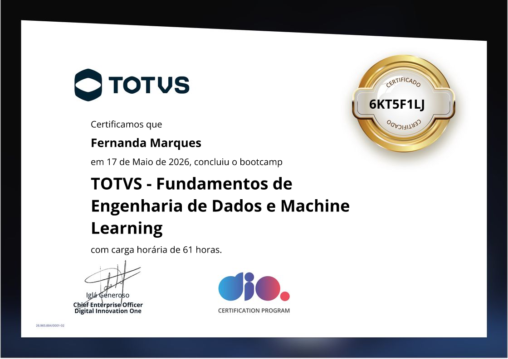

# Estudos em Ciência de Dados

Repositório dedicado à organização dos meus estudos durante o curso Fundamentos de Engenharia de Dados e Machine Learning.

## Conteúdos estudados

### Python

Exercícios introdutórios voltados ao desenvolvimento da lógica de programação e à compreensão dos principais recursos da linguagem.

- Estruturas básicas e lógica de programação;
- Manipulação de strings;
- Listas e operações com coleções;
- Dicionários (`dict`);
- Criação e utilização de funções;
- Resolução de exercícios práticos.

### SQL

Estudos introdutórios sobre bancos de dados relacionais, consultas e manipulação de informações utilizando SQL.

### ETL e Streaming

Práticas relacionadas aos fundamentos de Engenharia de Dados, incluindo:

- Processos de ETL (Extração, Transformação e Carga);
- Organização e processamento de dados;
- Separação entre dados brutos (*raw*) e processados (*processed*);
- Conceitos de streaming;
- Visualização de informações por meio de dashboards.

### AWS

Estudos introdutórios sobre computação em nuvem e serviços da Amazon Web Services, explorando possibilidades de aplicação em cenários empresariais.

## Projetos e estudos 

| Projeto | Descrição | Tecnologias |
|---|---|---|
| [Xbox Sales Dashboard](https://github.com/nanda-marques/xbox-sales-dashboard) | Dashboard de vendas do Xbox desenvolvido como parte do desafio de análise de dados. | Excel |
| [Spotify Data Analytics Dashboard](https://github.com/nanda-marques/spotify-data-analytics-dashboard) | Análise de dados do Spotify a partir de um dataset do Kaggle, com processo de ETL e dashboard interativo. | Python, Pandas e Streamlit |
| [Streaming Platforms ETL](https://github.com/nanda-marques/streaming-platforms-etl) | Pipeline de ETL para limpeza, transformação e análise de dados de plataformas de streaming, com visualizações interativas. | Python, Pandas, Streamlit e Power BI |
| [AWS Análise](https://github.com/nanda-marques/AWS-analise) | Proposta de redução de custos operacionais para uma empresa do setor farmacêutico, utilizando serviços de armazenamento, computação e banco de dados em nuvem. | AWS (S3, EC2 e RDS) |
| [Mensagens com IA Generativa](https://github.com/nanda-marques/mensagens-ia-generativa) | API REST para consulta e atualização de registros fictícios em um CSV. Usa IA generativa para criar mensagens personalizadas. | Python, Pandas e FastAPI |

---

## Certificação

**Fundamentos de Engenharia de Dados e Machine Learning**

- Instituição: DIO (Digital Innovation One)
- Parceira: TOTVS
- Carga horária: 61 horas

Formação complementar com conteúdos introdutórios relacionados à Engenharia de Dados e Machine Learning.

